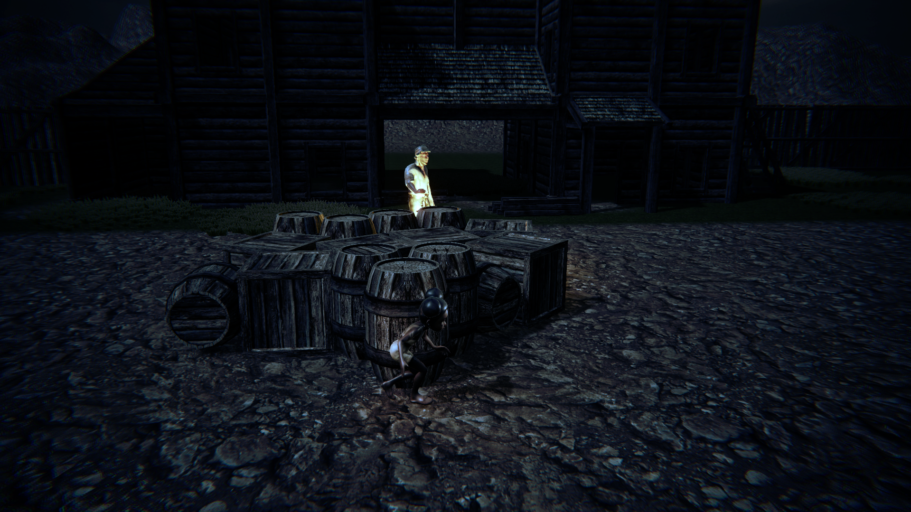
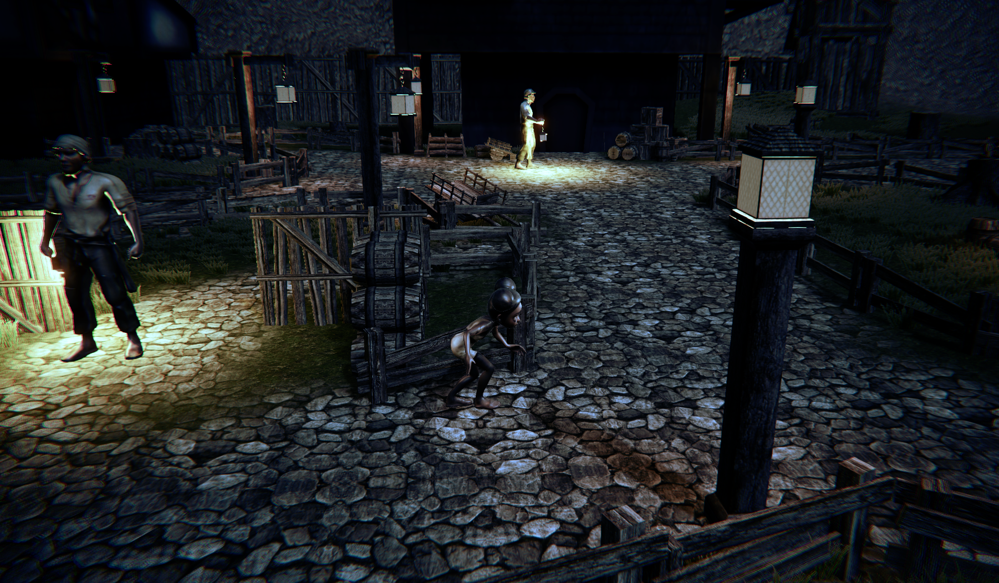
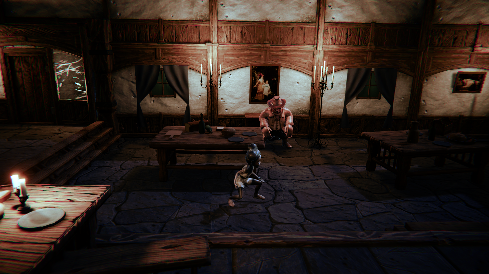
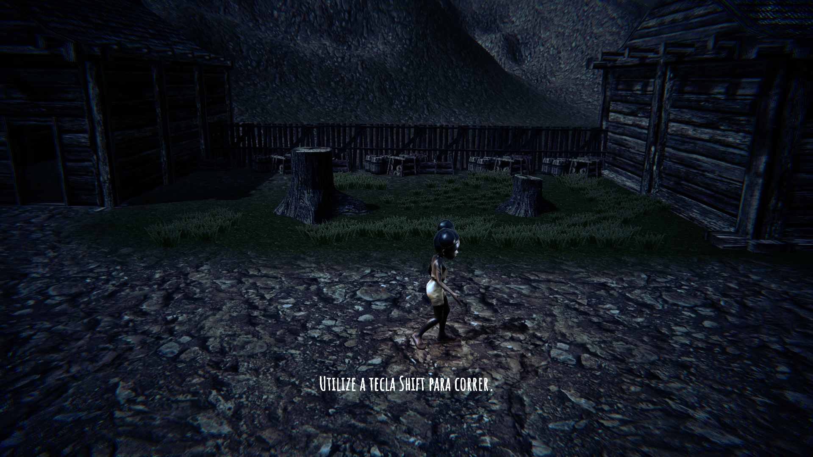

# Correntes da Noite

Em *Correntes da Noite*, você acompanha Amara, uma menina que vive em uma senzala. Numa noite silenciosa, um velho griô lhe entrega um colar de sementes com as memórias de quem tentou fugir antes, e ela entende que chegou a hora de encontrar o próprio caminho. Para escapar, Amara precisa atravessar o engenho sem ser vista pelos guardas, se esconder nas moitas, distrair os inimigos com pedras e fugir pela mata até o quilombo, onde descobre algo que sempre foi seu direito: a liberdade.

## Objetivo do desenvolvimento do jogo

Este jogo foi desenvolvido como **Trabalho de Conclusão de Curso (TCC)** do curso de Jogos Digitais no IFBA - Lauro de Freitas, com orientação de Herbert Monteiro. O foco técnico do projeto é a **IA de inimigos que percebem o jogador**: cada inimigo segue uma máquina de estados (ronda, alerta, perseguição, busca e captura), se move pelo NavMesh e percebe a personagem pela visão, pela luz da lanterna e pelo som dos passos e das pedras arremessadas.

## Link para Download:
**https://gustadimas.itch.io/correntes-da-noite**

## Imagens do jogo

- **Introdução**
  - A história de Amara é contada em cutscenes ilustradas antes e depois da fuga.

- **O engenho à noite**
  - Amara avança pelas sombras enquanto os guardas fazem a ronda.

- **Guardas com lanterna**
  - A luz da lanterna denuncia quem estiver na frente do guarda.

- **Dentro das construções**
  - Os inimigos também ouvem: passos, corridas e pulos perto deles chamam a atenção.

- **Tutorial**
  - Dicas na tela ensinam os controles, como correr com Shift.

- **Créditos**
  - Desenvolvido por Gustavo Dimas, com orientação de Herbert Monteiro.

## Tecnologias utilizadas

- **Unity 6 (Game Engine)**
- **C# (Programação de todos os sistemas do jogo)**
- **AI Navigation (NavMesh para a movimentação dos inimigos)**
- **Cinemachine (Câmeras)**
- **Input System (Controles para teclado, mouse e gamepad)**
- **POLYGON Nature Biomes, da Synty Studios (Cenários)**
